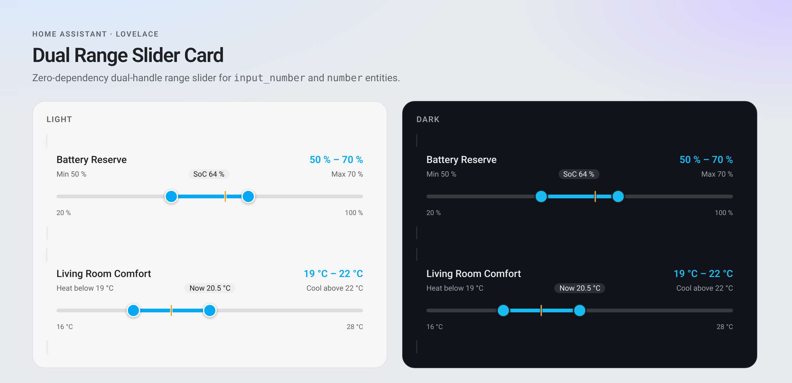

# Dual Range Slider Card

[](https://github.com/hacs/integration)
[](LICENSE)

A zero-dependency dual-handle range slider for Home Assistant Lovelace.
Bind the left and right handles to `input_number` or `number` entities, preview
values live while dragging, and write them back only when you release the
handle. An optional current-value entity can be shown as a badge and as a fine
marker on the scale.



Works as a standalone `ha-card` or compactly as a custom row inside an
`entities` card. Styling follows Home Assistant theme variables, so the card
matches both light and dark dashboards.

## Installation

### HACS (Custom Repository)

1. Open **HACS → Frontend**.
2. Open the menu (**⋮**) and choose **Custom repositories**.
3. Add `https://github.com/Don-Andi/ha-dual-range-slider-card`
   as a **Lovelace** / **Dashboard** repository.
4. Find **Dual Range Slider Card** and download it.
5. Restart Home Assistant or reload Lovelace resources if the card does not
   appear immediately.

HACS normally registers the resource for you. If you need to add it by hand:

```yaml
resources:
  - url: /hacsfiles/ha-dual-range-slider-card/dual-range-slider-card.js
    type: module
```

### Manual installation

1. Copy `dual-range-slider-card.js` to `<config>/www/`.
2. Add the resource under **Settings → Dashboards → Resources** (or in YAML):

```yaml
resources:
  - url: /local/dual-range-slider-card.js
    type: module
```

3. Reload the dashboard (or restart Home Assistant).

## Configuration

Add a card of type `custom:dual-range-slider-card`.

| Option | Type | Required | Default | Description |
|---|---|---|---|---|
| `min_entity` | string | yes | — | Left handle entity (`input_number.*` or `number.*`). |
| `max_entity` | string | yes | — | Right handle entity (`input_number.*` or `number.*`). |
| `title` | string | no | `""` | Card title. No header title is shown when empty. |
| `name` | string | no | — | Alias for `title` if `title` is omitted. |
| `min` | number | no | `min_entity` attribute `min`, else `0` | Scale start. |
| `max` | number | no | `min_entity` attribute `max`, else `100` | Scale end. |
| `step` | number | no | `min_entity` attribute `step`, else `1` | Snap increment. |
| `min_gap` | number | no | `step` | Minimum distance between the two handles. |
| `unit` | string | no | `min_entity` attribute `unit_of_measurement`, else `""` | Unit shown next to values. |
| `min_label` | string | no | `"Min"` | Label for the left handle. |
| `max_label` | string | no | `"Max"` | Label for the right handle. |
| `current_entity` | string | no | — | Optional sensor (or similar) shown as a badge and scale marker. |
| `current_label` | string | no | `"Current"` | Label for the current-value badge. |
| `compact` | boolean | no | auto | `true` renders a compact row without an inner `ha-card`. |
| `card_mode` | string | no | auto | `"card"` or `"row"`. Used when `compact` is not set. Auto-detects an `entities` card parent. |

The card calls `input_number.set_value` or `number.set_value` automatically
based on the entity domain. Values update live while dragging; the service
call runs on pointer release (and on keyboard changes).

## Examples

### 1. Battery reserve hysteresis

```yaml
type: custom:dual-range-slider-card
title: Battery Reserve
min_entity: input_number.battery_reserve_min
max_entity: input_number.battery_reserve_max
current_entity: sensor.battery_soc
current_label: SoC
min: 20
max: 100
step: 1
min_gap: 5
unit: "%"
```

### 2. Thermostat / temperature band

```yaml
type: custom:dual-range-slider-card
title: Living Room Comfort
min_entity: input_number.thermostat_min
max_entity: input_number.thermostat_max
current_entity: sensor.living_room_temperature
min_label: Heat below
max_label: Cool above
current_label: Now
min: 16
max: 28
step: 0.5
min_gap: 1
unit: "°C"
```

### 3. Humidity control

Uses `number` entities to show that both domains are supported:

```yaml
type: custom:dual-range-slider-card
title: Humidity Band
min_entity: number.humidifier_min
max_entity: number.humidifier_max
current_entity: sensor.bathroom_humidity
min_label: Humidify below
max_label: Dry above
unit: "%"
min: 0
max: 100
step: 1
min_gap: 5
```

### Entities card (compact row)

Set `compact: true` (or omit it and let the card detect that it already sits
inside an `entities` card) so the slider does not draw a second card frame:

```yaml
type: entities
title: Climate
entities:
  - entity: automation.humidity_control
    name: Humidity control
  - type: custom:dual-range-slider-card
    compact: true
    min_entity: number.humidifier_min
    max_entity: number.humidifier_max
    current_entity: sensor.bathroom_humidity
    unit: "%"
    min_gap: 5
```

## HACS default store

This card can be submitted to the official HACS default store after the GitHub
repository is published. Open a pull request against
[hacs/default](https://github.com/hacs/default) in the plugin category and
point it at this repository so the card appears in the HACS search without
adding a custom repository.

## License

MIT © 2026 DonAndi
